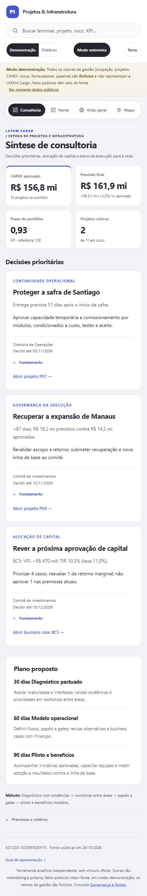

# Projetos e Infraestrutura · LATAM Cargo

Estudo independente para demonstrar **governança de CAPEX, priorização de investimentos e execução de projetos de infraestrutura** em uma entrevista. A abertura resume decisões, evidências, responsáveis e prazos; as demais telas permitem aprofundar a análise.

**[Abrir o portal](https://andremellotech.github.io/latam-cargo-projects-infrastructure/)** · [Roteiro executivo de 3 minutos](docs/CONSULTORIA.md) · [Roteiro completo e método de consultoria](docs/07-roteiro-do-consultor.md)

> Os valores de gestão são **fictícios** e não representam a LATAM Cargo. Fatos públicos têm fonte e data. O estudo é independente, sem vínculo oficial. O escopo de preparação foi informado pelo candidato; não é a reprodução de um anúncio oficial de vaga.



## Como apresentar

1. **Consultoria:** posição do portfólio e três decisões prioritárias - Santiago, Manaus e seleção de CAPEX.
2. **Aprofundamento:** abra o projeto ou business case correspondente pelos links de evidência. Painel, mapas e indicadores permanecem disponíveis no menu.
3. **Fechamento:** plano proposto de 30/60/90 dias, com diagnóstico, modelo operacional, piloto e benefícios acompanhados contra uma linha de base.

O **Modo entrevista** conduz cinco etapas: síntese → P07 → riscos → BC3 → plano. Ao sair, restaura o contexto anterior. A síntese reúne a rede inteira; as telas analíticas têm filtro de país. Os atalhos da síntese abrem explicitamente a rede inteira para localizar a evidência.

## As 12 visões

| Visão | Uso na conversa com o gestor |
|---|---|
| Consultoria | Quatro indicadores, três decisões e plano de execução |
| Painel | Curva S de CAPEX, OPEX, pauta executiva, prazos e KPIs |
| Visão geral | Contexto, fatos públicos e prioridades por localidade |
| Mapa | Demanda, corredores e camadas de análise |
| Terminais | Saúde operacional, metas, tendências e sazonalidade |
| Projetos | SPI/CPI/EAC, cronograma, curva S e priorização |
| Indicadores | Quadro executivo, financeiro, operacional e ponte da contribuição |
| Business cases | VPL/TIR/payback, sensibilidade e simulador |
| Riscos | Matriz, registro e mitigação |
| Fornecedores | Desempenho, custo, SLA e malha rodoviária |
| Negócios | Funil ponderado e hipóteses ligadas a evidências |
| Governança | Gates, interfaces, maturidade, workshop, metodologia e fontes |

Busca global, temas claro/escuro, modo TV e layout responsivo estão disponíveis em todas as visões. A composição usa código próprio e referências visuais públicas do [CodeXR no Topmate](https://topmate.io/code_xr) e do [Dashboard V16](https://www.instagram.com/reel/De1uvwiza9R/). Nenhuma compra ou código comercial foi utilizado.

## Dados e limites

- **Públicos:** fatos oficiais, fontes e score analítico próprio por localidade.
- **Demonstração:** dados sintéticos em `data/demo/`, com aviso permanente. A síntese executiva exige este modo e a marca `synthetic: true`.
- **Internos:** suporte a dados locais no mesmo formato, em ambiente privado. Esta pasta não contém dados reais e seu conteúdo de gestão é ignorado pelo Git. O modo público não expõe projetos, riscos ou valores demonstrativos.

Previsões não são resultados realizados; recomendações exigem validação técnica, financeira e das alçadas existentes. Os indicadores da rede são consolidados por somas e razões recalculadas.

## Executar e verificar

Portal estático em HTML, CSS e JavaScript, sem dependências de aplicação e sem compilação. **Node 20 ou superior** é necessário para servidor e testes.

```bash
npm start       # http://127.0.0.1:8080
npm test        # dados, cálculos, 12 telas, filtros, links e entrevista
```

Também é possível iniciar com `node scripts/serve.mjs`. O código-fonte precisa de servidor para ler os JSON; a cópia HTML offline fornecida para a entrevista já inclui os dados públicos e fictícios.

Os testes cobrem fórmulas financeiras e EVM, identidades dos KPIs, vínculos, escape de HTML, 144 renderizações das 12 visões, decisões da síntese, isolamento público/interno, filtros e restauração do estado da entrevista, inclusive sem demonstração disponível.

## Publicação e documentação

O site deste repositório é publicado pelo GitHub Pages a partir da `main`. Consulte [Publicação](docs/PUBLICACAO.md) para atualização e conferência do deploy.

[Escopo](docs/01-visao-geral/escopo.md) · [Metodologia](docs/03-metodologia/metodologia-gestao.md) · [Score de demanda](docs/03-metodologia/score-demanda.md) · [Dicionário](docs/04-padroes/dicionario-dados.md) · [Modo demonstração](docs/05-modo-demonstracao.md) · [Referências](docs/06-referencias-de-mercado.md) · [Consultoria e workshops](docs/07-roteiro-do-consultor.md) · [KPIs executivos](docs/08-revisao-executiva-de-kpis.md) · [Layout V16](docs/10-layout-v16.md)

Ver [Licença](LICENSE.md) e [Marcas e atribuições](NOTICE.md).
