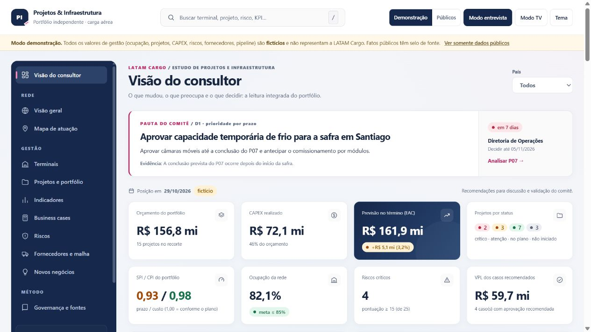
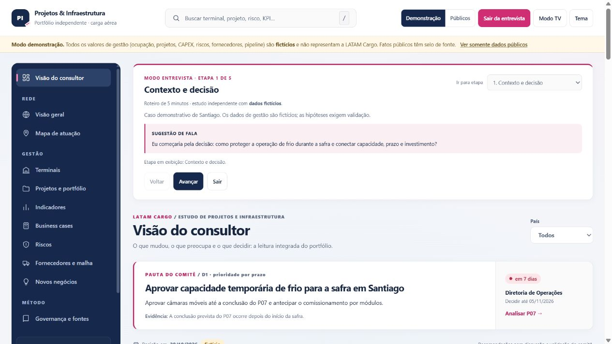
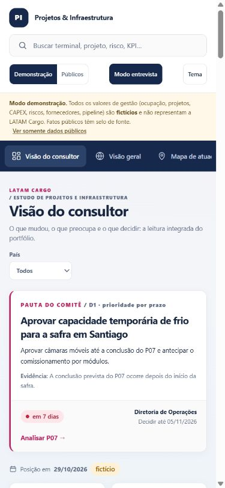

# Projetos e Infraestrutura · LATAM Cargo

Estudo independente para demonstrar, em uma entrevista, como transformar dados de terminais de carga em **decisões sobre prazo, CAPEX, riscos e continuidade operacional**. A apresentação parte de uma decisão, mostra as evidências e termina com responsáveis, próximos passos e critérios de acompanhamento.

O **Modo entrevista** guia uma demonstração de cinco minutos pelo caso fictício de cadeia fria em Santiago: **contexto → projeto P07 → riscos → business case BC3 → plano**. O [roteiro de apresentação](docs/07-roteiro-do-consultor.md) inclui perguntas para discussão, limites, diagnóstico de maturidade, pauta de workshop executivo e fluxo proposto do investimento aos benefícios.

O escopo informado para esta preparação abrange governança de capital, modelos operacionais de engenharia, implantação e investimentos, transformação organizacional e melhoria contínua dos processos. O estudo não representa resultados reais da LATAM nem comprova requisitos de um anúncio oficial de vaga.

Portal estático em **HTML, CSS e JavaScript, sem dependências de aplicação**. Preserva mapa de demanda com score por localidade, portfólio com valor agregado, indicadores por terminal, business cases, riscos, fornecedores e novos negócios; não há instalação de pacotes nem etapa de compilação.

> **Três camadas de dados, sempre identificadas na tela**
> - **Públicos:** fatos oficiais com fonte e data de acesso, e o score analítico por localidade.
> - **Demonstração:** dados de gestão **fictícios** (`data/demo/`) para mostrar como ficaria a gestão completa. Faixa de aviso permanente.
> - **Internos:** os dados reais, no mesmo formato da demonstração (`data/internal/`), só em ambiente privado.



## Visão do consultor
A primeira tela responde: **o que decidir, com quais evidências e até quando.** A pauta de decisões aparece antes das métricas. As mensagens-chave calculadas por regras, os próximos prazos e os atalhos conectam cada recomendação ao projeto, risco ou contrato correspondente. Indicadores do portfólio, metas, OPEX orçado × realizado, KPIs executivos da rede e plano de 30, 60 e 90 dias apoiam o aprofundamento.

## Layout executivo e apresentação guiada
Paleta de **azul-marinho, branco e magenta**, superfícies mais sóbrias e hierarquia orientada à pauta de decisões. A navegação, a **busca global** (`/` para focar), os temas claro e escuro e o modo TV continuam disponíveis. O Modo entrevista organiza a exposição em cinco etapas sem alterar os dados da demonstração.



O painel se adapta à tela do celular, mantendo a pauta de decisões e o acesso às análises.



Referências de inspiração visual pública: [perfil CodeXR no Topmate](https://topmate.io/code_xr) e [Dashboard v14](https://topmate.io/code_xr/2363309). Nenhuma compra foi realizada e nenhum código desses produtos foi utilizado. O documento [`docs/09-design-vidro.md`](docs/09-design-vidro.md) e as [capturas anteriores](docs/img/) preservam o **histórico** da interface em vidro, sem representar o layout atual.

## Telas
| Tela | O que mostra |
|---|---|
| Visão do consultor | Pauta de decisões antes das métricas, mensagens-chave, indicadores do portfólio, metas, OPEX orçado × realizado, plano de 30/60/90 dias, próximos prazos e atalhos |
| Visão geral / Mapa de atuação | Fatos públicos, score, camadas de demanda, corredores; mapa colorível por score, ocupação ou saúde |
| Terminais | Mapa de calor de saúde (6 dimensões), KPIs com semáforo e tendência, drill-down com sazonalidade |
| Projetos e portfólio | Status com SPI/CPI/EAC, Gantt com semáforo, curva S, matriz impacto x esforço, CAPEX por tipo |
| Indicadores | Abas **Executivo** (leitura, quadro, mapa de calor, ponte da contribuição), **Financeiros** e **Operacionais** (cartões da rede, detalhe por terminal, ponte do OPEX, financeiro do portfólio, dicionário) |
| Business cases | Carteira com VPL/TIR/payback, cascata, tornado, fluxo acumulado e simulador |
| Riscos | Matriz 5x5, registro e mitigação |
| Fornecedores e malha | Scorecard de ground handling e transportadoras, custo x SLA, rotas rodoviárias |
| Novos negócios | Funil com valor ponderado e hipóteses ligadas a evidências públicas |
| Governança e fontes | Metodologia, regras de dados, referências de mercado e fontes |

## KPIs com foco executivo
São **18 KPIs** (7 financeiros e 11 operacionais) em dois níveis. Oito são **executivos** e respondem cada um a uma pergunta de gestão; os outros dez são **de apoio** e explicam o que move os executivos.

| Pilar | KPI executivo |
|---|---|
| Resultado | Contribuição · Margem de contribuição |
| Custo | Custo por tonelada |
| Capacidade | Ocupação da capacidade |
| Cliente | Nível de serviço |
| Qualidade | Avarias e extravios · Cargas fora da faixa de temperatura |
| Segurança | Incidentes operacionais |

- **Leitura executiva:** de 3 a 5 frases calculadas dos dados (nada escrito à mão).
- **Quadro executivo:** status, meta, variação, **meses fora da meta**, terminais em vermelho/atenção/na meta, pior terminal e **efeito em R$**.
- **Mapa de calor terminal × KPI:** mostra o que a média da rede esconde (com símbolos além da cor).
- **Ponte da contribuição:** o desvio contra o orçado fecha exatamente em volume, receita por tonelada e custo por tonelada.
- **Metas coerentes:** a meta de margem é derivada das de receita e custo por tonelada.
- **Cada KPI** traz definição, fórmula, responsável, **por que importa** e **o que o move**.
- A **rede** é consolidada por somas e razões recalculadas, não por média de médias.

A revisão que levou a este desenho, com os achados e as limitações, está em [`docs/08-revisao-executiva-de-kpis.md`](docs/08-revisao-executiva-de-kpis.md).

## Executar
```bash
npm start     # http://localhost:8080  (precisa de servidor; file:// bloqueia a leitura dos JSON)
npm test      # valida dados, regras, telas, links e integração
```
Não há instalação nem etapa de compilação. Node 20 ou superior é usado apenas para os testes.

## Publicar no GitHub Pages
Guia completo, com solução de problemas: [`docs/PUBLICACAO.md`](docs/PUBLICACAO.md). Resumo: envie o **conteúdo** da pasta para a branch `main`, ative **Settings → Pages → Source: GitHub Actions** e acompanhe a aba **Actions**.
O workflow roda os testes, **exclui `data/internal/`** do site e, se a variável `PUBLISH_DEMO` for `false`, também exclui a demonstração.

## Trocar a demonstração pelos dados reais
1. Copie `data/demo/` para `data/internal/` e substitua o conteúdo (formato em [`docs/04-padroes/dicionario-dados.md`](docs/04-padroes/dicionario-dados.md)).
2. Em `data/internal/meta.json`, remova `"synthetic": true`.
3. Rode `npm test` e abra com `npm start` ou em intranet. O modo **Internos** aparece sozinho.

O GitHub Pages é público por padrão: **não publique dados internos nele.**

## Estrutura
```
index.html · styles.css
js/        core, analytics, charts, views-common, views-public, views-mgmt, interview, app
data/      públicos (config, locations, sources…), demo/ (fictícios), internal/ (privado)
scripts/   build-demo.py · build-map.py · validate.mjs · smoke-test.mjs · briefing-test.mjs · interview-test.js · ui-test.js · e2e-browser.py
docs/      escopo, governança, metodologia, dicionário de dados, modo demonstração, referências, roteiro
```

## Documentação
[Escopo](docs/01-visao-geral/escopo.md) · [Metodologia de gestão](docs/03-metodologia/metodologia-gestao.md) · [Score por localidade](docs/03-metodologia/score-demanda.md) · [Dicionário de dados](docs/04-padroes/dicionario-dados.md) · [Modo demonstração](docs/05-modo-demonstracao.md) · [Referências de mercado](docs/06-referencias-de-mercado.md) · [Roteiro de entrevista e apresentação](docs/07-roteiro-do-consultor.md) · [Revisão executiva dos KPIs](docs/08-revisao-executiva-de-kpis.md) · [Histórico do design em vidro](docs/09-design-vidro.md) · [Publicação](docs/PUBLICACAO.md)

## Qualidade
`npm test` reúne validação de dados e regras, renderização das telas, testes da pauta executiva e do roteiro de entrevista e integração do `app.js` com um DOM simulado. As verificações cobrem fórmulas financeiras e EVM, vínculos, datas, links, escape de HTML, isolamento do modo público e identidades dos KPIs, incluindo a ponte da contribuição, as metas e a consolidação da rede.

- **Pauta executiva (`briefing-test.mjs`):** prioriza a decisão por prazo, respeita o país selecionado, abre o projeto correspondente e mantém decisões fictícias fora do modo público.
- **Entrevista (`interview-test.js`):** verifica entrada, cinco etapas, seleção de P07/BC3, limites da navegação, exploração livre e restauração do estado anterior, incluindo filtros e alterações no simulador.
- **Integração (`ui-test.js`):** confere os controles do roteiro, a retomada da etapa e a restauração de tela, seleção, filtros e modo ao sair. A execução adicional com `--without-demo` verifica que o roteiro permanece indisponível sem dados demonstrativos e que o portal inicia no modo público.

O script opcional `scripts/e2e-browser.py` complementa a análise em navegador real (Playwright + Chromium), com verificações de layout em celular, busca por teclado e preferências de movimento. A aparência e a legibilidade da apresentação também devem ser conferidas no navegador antes da entrevista.

## Licença e marcas
Ver `LICENSE.md` e `NOTICE.md`. Ferramenta independente, sem vínculo oficial; o uso de nomes e marcas LATAM deve seguir as diretrizes corporativas.
