# Projetos e Infraestrutura · LATAM Cargo

Portal analítico estático (HTML, CSS e JavaScript, **sem dependências**) para a consultoria de projetos e infraestrutura de terminais de carga: visão do consultor, mapa de demanda com score por localidade, portfólio de projetos com valor agregado, indicadores por terminal, business cases, riscos, fornecedores e novos negócios.

> **Três camadas de dados, sempre identificadas na tela**
> - **Públicos:** fatos oficiais com fonte e data de acesso, e o score analítico por localidade.
> - **Demonstração:** dados de gestão **fictícios** (`data/demo/`) para mostrar como ficaria a gestão completa. Faixa de aviso permanente.
> - **Internos:** os dados reais, no mesmo formato da demonstração (`data/internal/`), só em ambiente privado.

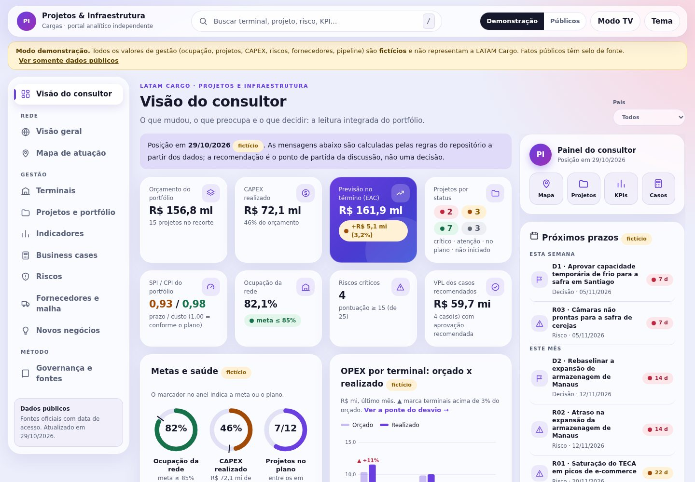

## Visão do consultor
A primeira tela responde: **o que mudou, o que preocupa e o que decidir.** Reúne oito indicadores do portfólio (com ícones), as metas em anéis, o OPEX orçado × realizado por terminal, as mensagens-chave calculadas por regras (com recomendação e link para o item), as decisões necessárias ao comitê, o quadro de KPIs executivos da rede, o plano de 30, 60 e 90 dias e, ao lado, os **próximos prazos** e atalhos.

## Visual em vidro
Tema de **vidro fosco** em dois estilos (claro e escuro), com menu de ícones e indicador deslizante, **busca global** (`/` para focar), anéis de metas, barras agrupadas e painel lateral de prazos. Contraste (mínimo 4,5:1), transparência reduzida, movimento reduzido e modo TV tratados e testados. Detalhes e referências: [`docs/09-design-vidro.md`](docs/09-design-vidro.md).

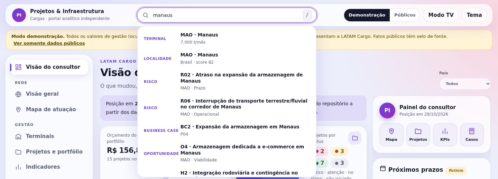
<table><tr>
<td>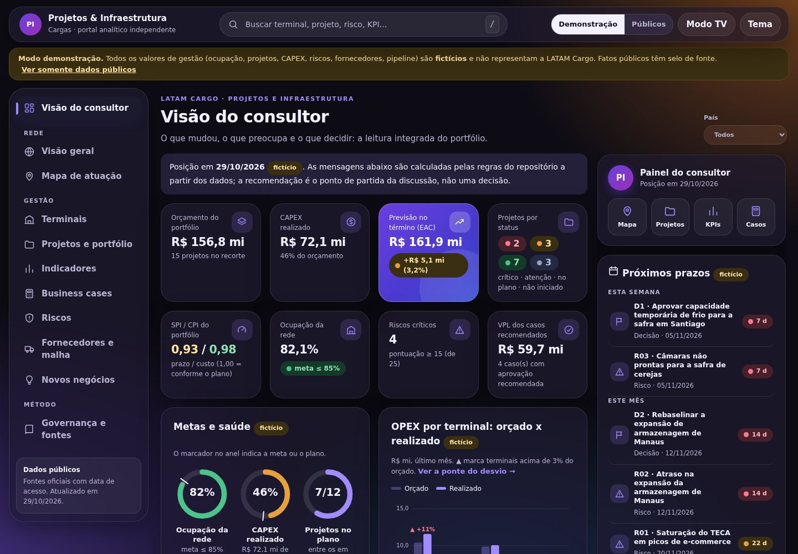</td>
<td>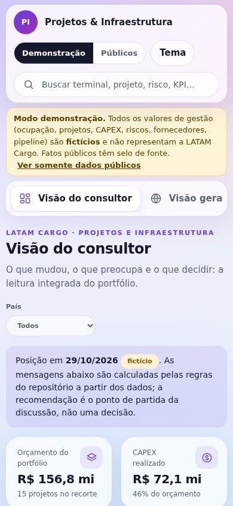</td>
</tr><tr>
<td colspan="2">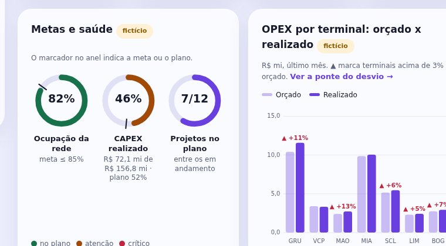</td>
</tr></table>

## Telas
| Tela | O que mostra |
|---|---|
| Visão do consultor | Cartões com ícones, anéis de metas, OPEX orçado × realizado, mensagens-chave, decisões, plano de 30/60/90 dias, próximos prazos e atalhos |
| Visão geral / Mapa de atuação | Fatos públicos, score, camadas de demanda, corredores; mapa colorível por score, ocupação ou saúde |
| Terminais | Mapa de calor de saúde (6 dimensões), KPIs com semáforo e tendência, drill-down com sazonalidade |
| Projetos e portfólio | Status com SPI/CPI/EAC, Gantt com semáforo, curva S, matriz impacto x esforço, CAPEX por tipo |
| Indicadores | Abas **Executivo** (leitura, quadro, mapa de calor, ponte da contribuição), **Financeiros** e **Operacionais** (cartões da rede, detalhe por terminal, ponte do OPEX, financeiro do portfólio, dicionário) |
| Business cases | Carteira com VPL/TIR/payback, cascata, tornado, fluxo acumulado e simulador |
| Riscos | Matriz 5x5, registro e mitigação |
| Fornecedores e malha | Scorecard de ground handling e transportadoras, custo x SLA, rotas rodoviárias |
| Novos negócios | Funil com valor ponderado e hipóteses ligadas a evidências públicas |
| Governança e fontes | Metodologia, regras de dados, referências de mercado e fontes |

<table><tr>
<td>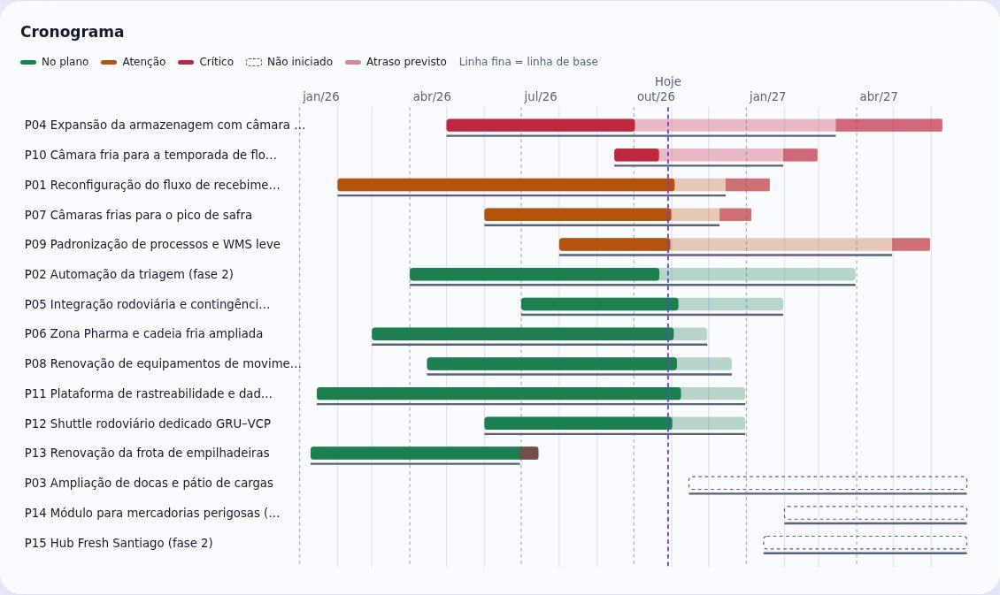</td>
<td>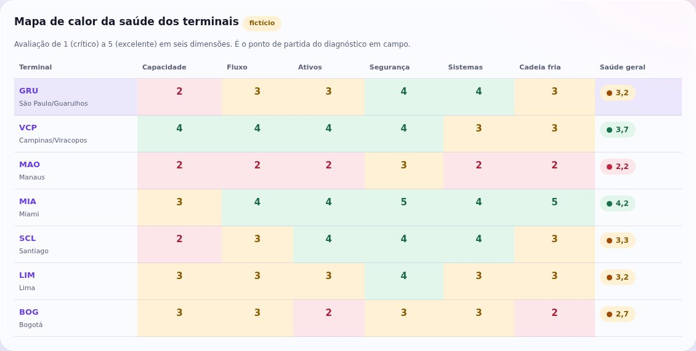</td>
</tr><tr>
<td>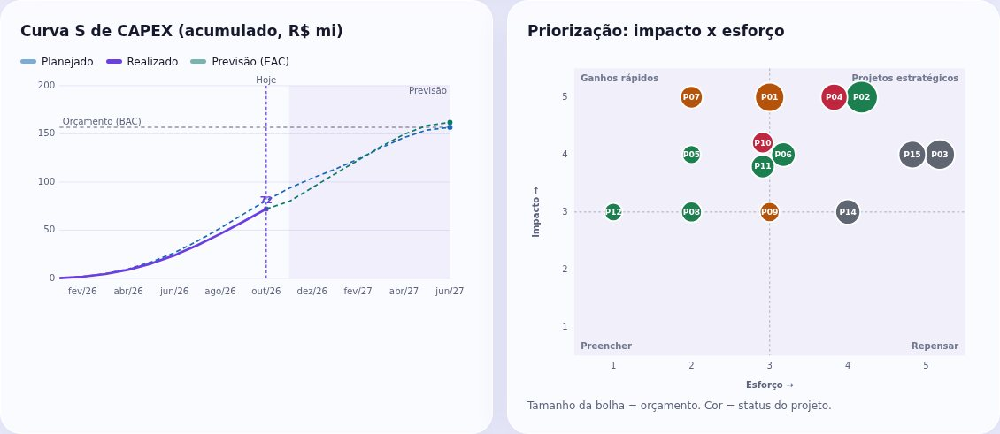</td>
<td>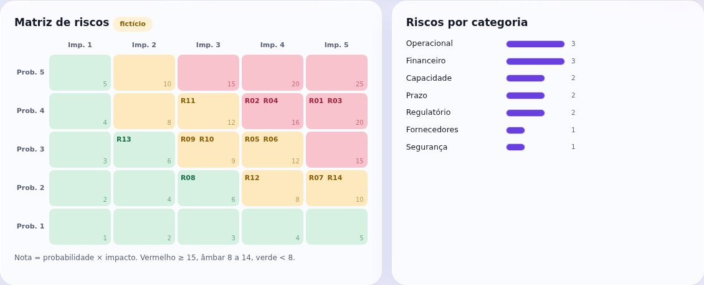</td>
</tr></table>

## KPIs com foco executivo
São **18 KPIs** (7 financeiros e 11 operacionais) em dois níveis. Oito são **executivos** e respondem cada um a uma pergunta de gestão; os outros dez são **de apoio** e explicam o que move os executivos.

| Pilar | KPI executivo |
|---|---|
| Resultado | Contribuição · Margem de contribuição |
| Custo | Custo por tonelada |
| Capacidade | Ocupação da capacidade |
| Cliente | Nível de serviço |
| Qualidade | Avarias e extravios · Cargas fora da faixa de temperatura |
| Segurança | Incidentes operacionais |

- **Leitura executiva:** de 3 a 5 frases calculadas dos dados (nada escrito à mão).
- **Quadro executivo:** status, meta, variação, **meses fora da meta**, terminais em vermelho/atenção/na meta, pior terminal e **efeito em R$**.
- **Mapa de calor terminal × KPI:** mostra o que a média da rede esconde (com símbolos além da cor).
- **Ponte da contribuição:** o desvio contra o orçado fecha exatamente em volume, receita por tonelada e custo por tonelada.
- **Metas coerentes:** a meta de margem é derivada das de receita e custo por tonelada.
- **Cada KPI** traz definição, fórmula, responsável, **por que importa** e **o que o move**.
- A **rede** é consolidada por somas e razões recalculadas, não por média de médias.

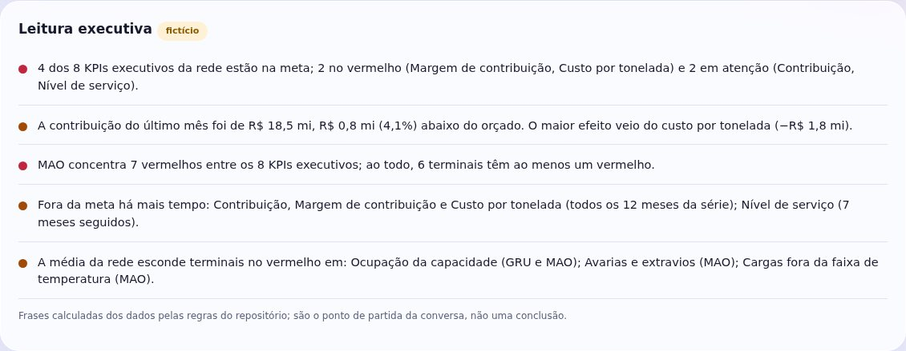
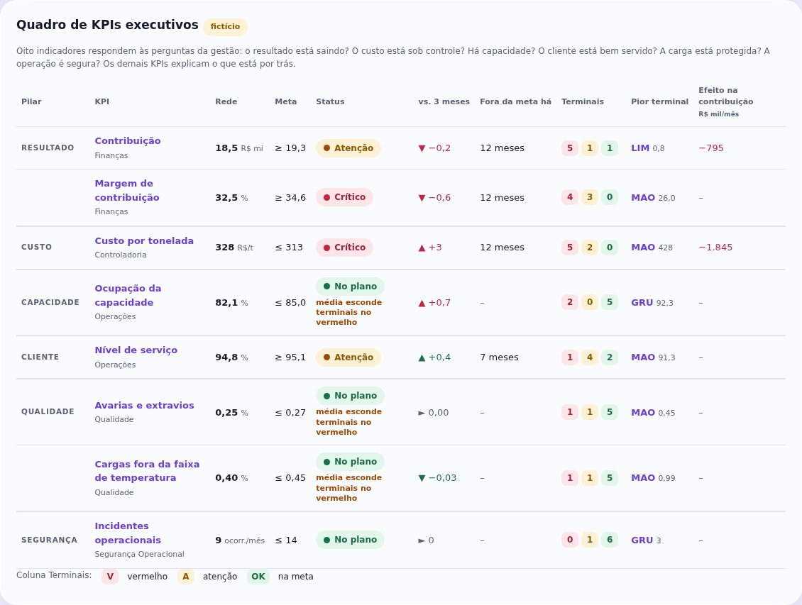
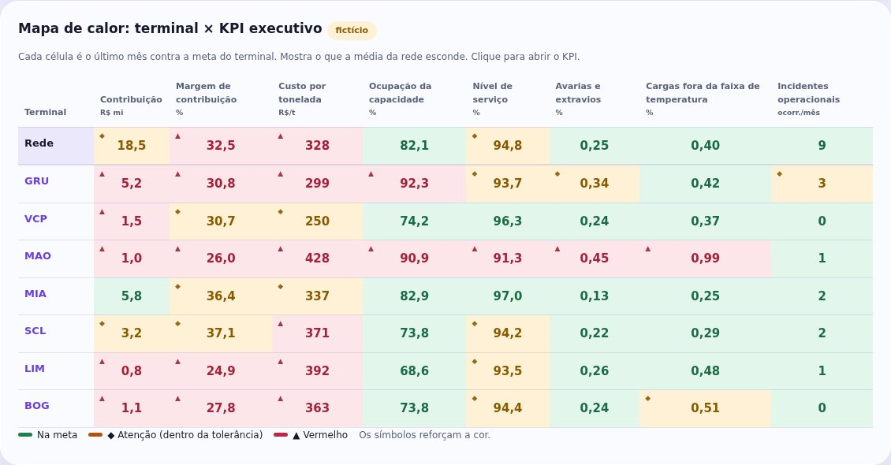
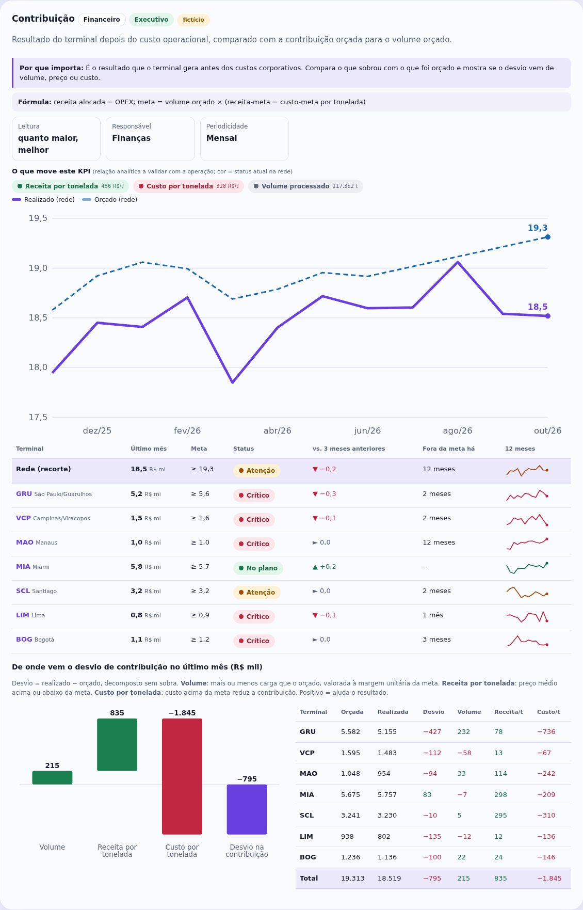

A revisão que levou a este desenho, com os achados e as limitações, está em [`docs/08-revisao-executiva-de-kpis.md`](docs/08-revisao-executiva-de-kpis.md).

## Executar
```bash
npm start     # http://localhost:8080  (precisa de servidor; file:// bloqueia a leitura dos JSON)
npm test      # valida dados, regras, telas, links e integração
```
Não há instalação nem etapa de compilação. Node 20 ou superior é usado apenas para os testes.

## Publicar no GitHub Pages
Guia completo, com solução de problemas: [`docs/PUBLICACAO.md`](docs/PUBLICACAO.md). Resumo: envie o **conteúdo** da pasta para a branch `main`, ative **Settings → Pages → Source: GitHub Actions** e acompanhe a aba **Actions**.
O workflow roda os testes, **exclui `data/internal/`** do site e, se a variável `PUBLISH_DEMO` for `false`, também exclui a demonstração.

## Trocar a demonstração pelos dados reais
1. Copie `data/demo/` para `data/internal/` e substitua o conteúdo (formato em [`docs/04-padroes/dicionario-dados.md`](docs/04-padroes/dicionario-dados.md)).
2. Em `data/internal/meta.json`, remova `"synthetic": true`.
3. Rode `npm test` e abra com `npm start` ou em intranet. O modo **Internos** aparece sozinho.

O GitHub Pages é público por padrão: **não publique dados internos nele.**

## Estrutura
```
index.html · styles.css
js/        core, analytics, charts, views-common, views-public, views-mgmt, app
data/      públicos (config, locations, sources…), demo/ (fictícios), internal/ (privado)
scripts/   build-demo.py · build-map.py · validate.mjs · smoke-test.mjs · ui-test.js · e2e-browser.py
docs/      escopo, governança, metodologia, dicionário de dados, modo demonstração, referências, roteiro
```

## Documentação
[Escopo](docs/01-visao-geral/escopo.md) · [Metodologia de gestão](docs/03-metodologia/metodologia-gestao.md) · [Score por localidade](docs/03-metodologia/score-demanda.md) · [Dicionário de dados](docs/04-padroes/dicionario-dados.md) · [Modo demonstração](docs/05-modo-demonstracao.md) · [Referências de mercado](docs/06-referencias-de-mercado.md) · [Roteiro de apresentação](docs/07-roteiro-do-consultor.md) · [Revisão executiva dos KPIs](docs/08-revisao-executiva-de-kpis.md) · [Design em vidro](docs/09-design-vidro.md) · [Publicação](docs/PUBLICACAO.md)

## Qualidade
`npm test` executa três grupos de verificação: (1) dados e regras (somas, vínculos, datas, fórmulas financeiras com valores de referência, EVM, contraste de cores); (2) renderização de todas as telas em todos os modos, links entre telas, escape de HTML e isolamento do modo público; (3) integração do `app.js` com um DOM simulado. O teste de dados confere também as identidades dos KPIs (OPEX = volume × custo, contribuição = receita − OPEX, margem, aderência ao orçamento), a ponte da contribuição, a duração fora da meta, a coerência entre metas e a consolidação da rede; exige de 6 a 9 KPIs executivos e de 3 a 5 frases na leitura executiva. O teste de dados confere também o **contraste do tema de vidro** (calculado a partir do `styles.css`), os próximos prazos, os anéis, as barras e a busca. O script opcional `scripts/e2e-browser.py` repete a verificação num navegador real (Playwright + Chromium): estouro horizontal em celular, estados do painel de KPIs, busca por teclado, indicador do menu, desfoque no modo TV e movimento reduzido.

## Licença e marcas
Ver `LICENSE.md` e `NOTICE.md`. Ferramenta independente, sem vínculo oficial; o uso de nomes e marcas LATAM deve seguir as diretrizes corporativas.
