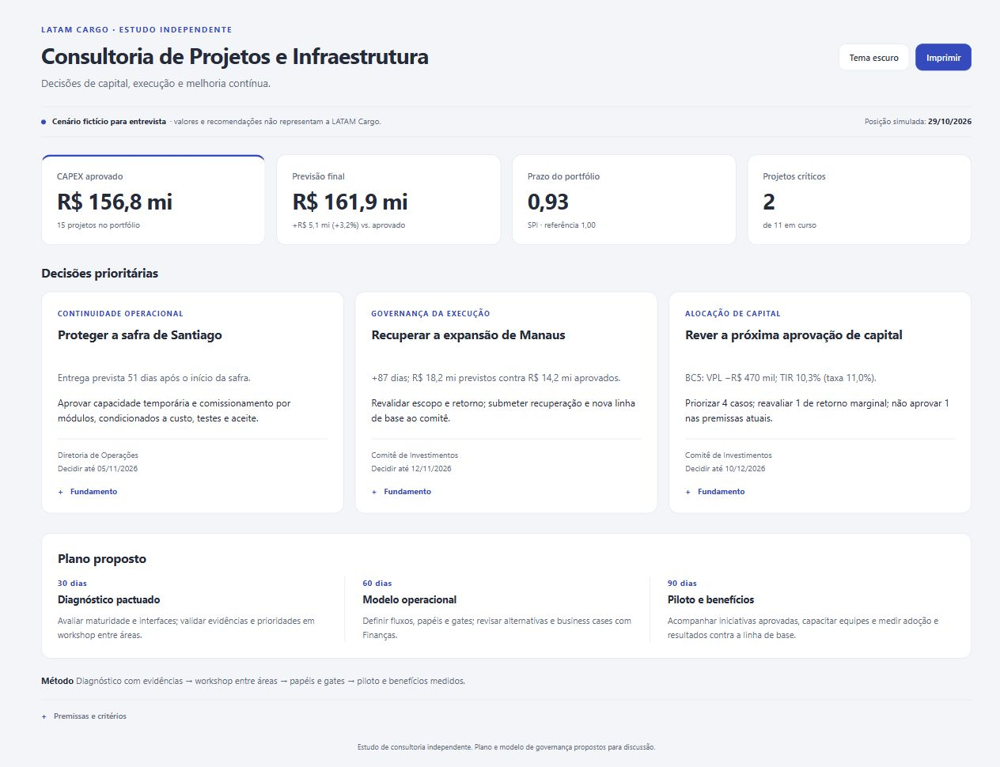

# Visão de Consultoria · LATAM Cargo

Página executiva para discutir **capital, prazo e decisões de investimento**: quatro indicadores, três decisões prioritárias e um plano proposto de 30/60/90 dias.

> **Estudo independente com dados de gestão fictícios.** As recomendações são propostas para discussão; não representam resultados reais da LATAM, experiência executada pelo autor ou requisitos verificados de uma vaga.



## Posição do portfólio

| Indicador | Cenário demonstrativo |
|---|---|
| CAPEX aprovado | R$ 156,8 milhões |
| Previsão no término | R$ 161,9 milhões · +R$ 5,1 milhões / +3,2% |
| Índice de prazo (SPI) | 0,93 |
| Projetos críticos | 2 |

## Três decisões

- **Santiago:** capacidade definitiva prevista 51 dias após o início da safra. Avaliar contingência de frio e comissionamento por módulos.
- **Manaus:** previsão de atraso de 87 dias e custo aproximadamente 28% acima do orçamento. Condicionar a revisão da linha de base a um plano de recuperação.
- **Próxima janela de CAPEX:** reavaliar BC4, de retorno marginal, e não aprovar BC5 nas premissas atuais: VPL de cerca de −R$ 470 mil e TIR de 10,3%, abaixo da taxa de 11%.

Cada decisão tem seu **Fundamento** expansível na própria página. **Tema** e **Imprimir** são as ações utilitárias.

## Plano proposto

**30 dias:** diagnóstico de maturidade e workshop executivo. **60 dias:** modelo operacional e pontos de decisão do investimento (gates). **90 dias:** piloto aprovado e acompanhamento dos benefícios.

[Roteiro de apresentação em três minutos](docs/CONSULTORIA.md).

## Abrir

Com Node.js 20 ou superior, execute na pasta do repositório:

```sh
npm start
```

Ou execute diretamente `node scripts/serve.mjs`. Abra [localhost:8080](http://localhost:8080). Não é necessário executar `npm install`.

## Verificar

```sh
npm test
```

Executa os testes financeiros, de cenários e da aplicação, incluindo o servidor local.

Inspiração visual: [CodeXR Dashboard V16](https://www.instagram.com/reel/De1uvwiza9R/). Adaptação com código próprio.
